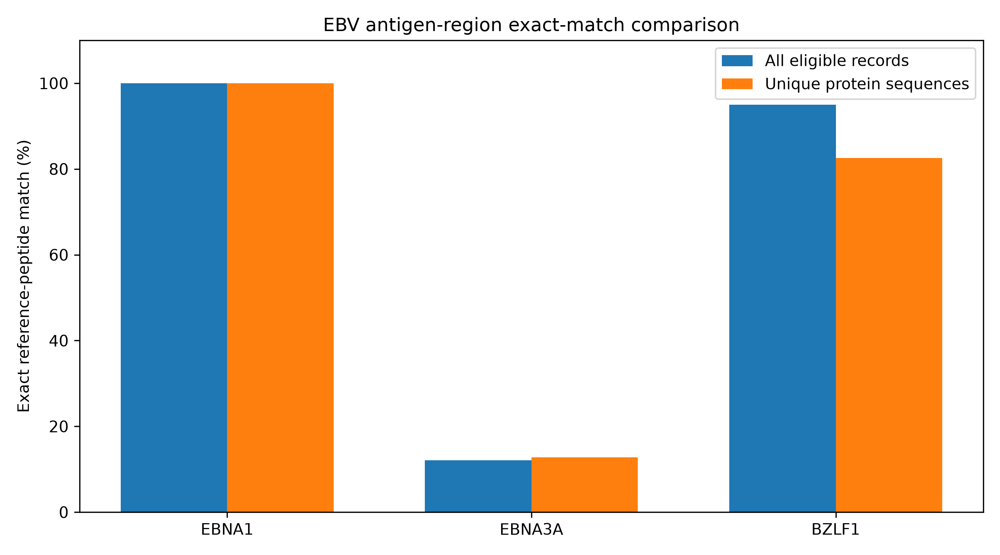
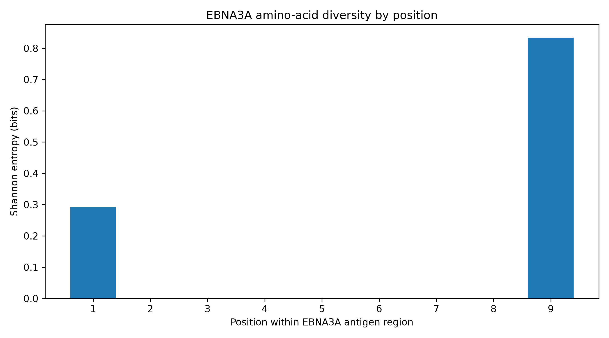
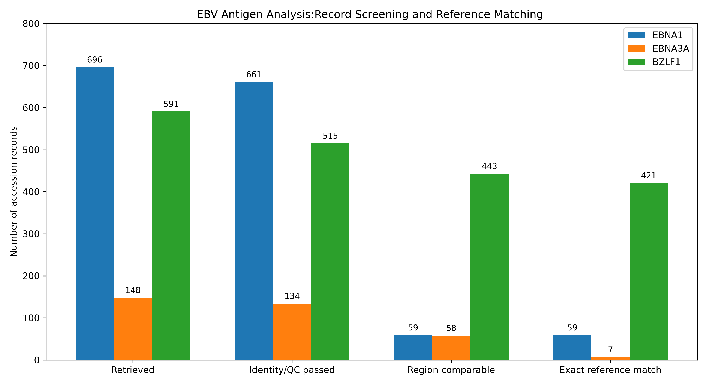

# Sequence Conservation and Variation in Selected Epstein–Barr Virus Antigen Regions

## Project Overview

Epstein–Barr virus (EBV) has been strongly associated with multiple sclerosis (MS), a chronic inflammatory disease of the central nervous system.

Several studies have investigated immune responses to EBV proteins in individuals with MS, raising questions about the molecular characteristics of viral regions recognized by the immune system.

This project examines the sequence conservation and amino acid variability of three selected antigen regions from the EBV proteins EBNA1, EBNA3A, and BZLF1.

A Python-based computational workflow was developed to retrieve public protein sequences, assess sequence quality and protein identity, perform multiple sequence alignment, identify peptide variants, and quantify reference-peptide matching and position-specific variation.

## Scientific Background and Rationale

### Epstein–Barr Virus and Multiple Sclerosis

Evidence from epidemiological and immunological studies supports a strong relationship between EBV infection and MS.

Bjornevik et al. (2022) reported a substantially increased risk of MS following EBV infection in a large longitudinal cohort, strengthening the evidence for EBV involvement in MS development.

Beyond epidemiological associations, studies of immune responses to EBV proteins have identified specific viral antigen regions recognized by antibodies or T cells from individuals with MS.

These findings motivate further investigation of the sequence characteristics of selected EBV antigen regions.

### Why Were These Three Antigen Regions Selected?

**EBNA1: Antibody Recognition and Molecular Mimicry**

Lanz et al. (2022) investigated molecular mimicry between EBV nuclear antigen 1 (EBNA1) and the human central nervous system protein GlialCAM.

The study identified antibodies associated with MS that recognized EBNA1 and cross-reacted with GlialCAM. The investigated EBNA1 region included amino acid positions 386–405.

This provides an immunological rationale for examining sequence conservation within the selected EBNA1 region.

**EBNA3A: EBV-Specific CD8+ T-Cell Recognition**

Hayashi et al. (2026) examined the antigen specificity of expanded CD8+ T-cell populations in individuals with MS.

The study identified T-cell receptor recognition of the EBNA3A-derived peptide `FLRGRAYGL`, presented in the context of HLA-B*08:01.

The published peptide was reported at EBNA3A positions 193–201. The reference sequence used in the present computational analysis, however, contains the closely related peptide `FLRGRAYGI` at positions 325–333.

This reference-coordinate and peptide difference is explicitly acknowledged. The current analysis uses the selected RefSeq sequence for positional mapping; equivalence of the published coordinates has not been independently resolved.

**BZLF1: Recognition of a Lytic EBV Antigen**

The study by Hayashi et al. (2026) also reported recognition of the BZLF1-derived peptide `EPLPQGQLTAY` by an EBV-specific CD8+ T-cell receptor from an individual with MS, in the context of HLA-B*35:01.

This observation provides a rationale for investigating sequence variation within the selected BZLF1 antigen region.

### Motivation for the Present Analysis

The cited immunological studies establish the relevance of these viral antigen regions to research on MS-associated immune responses.

However, recognizing an antigen region does not establish that its amino acid sequence is identical across publicly available viral protein records.

This project therefore addresses a complementary, sequence-based question:

**How conserved are selected EBV antigen regions in publicly available protein sequences, and which amino acid positions exhibit variation?**

The project does not directly evaluate immune responses in patients or test whether sequence variants contribute to MS development.

## Research Objectives

1. Assess reference-peptide exact-match frequencies within three selected EBV antigen regions.
2. Identify alternative peptide sequences and amino acid substitutions.
3. Evaluate amino acid variability at individual positions using frequencies and Shannon entropy.
4. Compare record-level findings with results obtained after deduplication of identical protein sequences.

## Reference Proteins and Target Regions

| Protein | Reference Accession | Reference Positions | Reference Peptide |
|---|---|---|---|
| EBNA1 | YP_401677.1 | 386–405 | SQSSSSGSPPRRPPPGRRPF |
| EBNA3A | YP_401669.1 | 325–333 | FLRGRAYGI |
| BZLF1 | YP_401673.1 | 54–64 | EPLPQGQLTAY |

All positions use one-based indexing relative to the specified reference sequences.

The EBNA3A coordinate discrepancy between the published immunological epitope and the selected computational reference requires caution when interpreting the results.

## Data Collection

Protein records were retrieved from the NCBI Protein database using Biopython Entrez.

The initial search returned 1,435 candidate records.

| Protein | Initially Retrieved Records |
|---|---:|
| EBNA1 | 696 |
| EBNA3A | 148 |
| BZLF1 | 591 |
| **Total** | **1,435** |

Retrieved FASTA sequences and accession-associated metadata were organized for subsequent analysis.

Initial search results were treated as candidate records rather than automatically accepted examples of the target proteins.

## Computational Methods

### 1. Sequence Quality Control

Downloaded records were screened for protein identity, sequence length, nonstandard amino acid characters, and duplicate sequences.

Records with unresolved annotations or unsuitable sequence characteristics were flagged for review or exclusion.

### 2. Protein Identity Screening and Validation

Protein descriptions were initially screened using target-specific name patterns.

Additional investigation was performed for records with ambiguous annotations.

For BZLF1, 170 records initially required identity review. Pairwise alignment against the selected BZLF1 reference identified 99 sequences with high reference coverage and amino acid identity according to exploratory screening thresholds.

Subsequent examination of GenBank gene annotations identified 97 records explicitly annotated with the BZLF1 gene. These records were incorporated into the updated analysis.

Two records remained unresolved by this procedure and were not recovered into the primary dataset.

### 3. Multiple Sequence Alignment

Screened sequences were aligned using PyFAMSA.

Identical protein sequences were deduplicated for alignment, and the selected reference protein was retained to facilitate reference-relative mapping.

### 4. Antigen Region Mapping

Antigen regions were extracted using positions defined relative to the reference sequence in the multiple sequence alignment.

Only records with a fully comparable peptide under the implemented mapping criteria were retained for the exact-match calculations.

### 5. Peptide Variant Analysis

Each extracted antigen-region sequence was compared with the corresponding reference peptide.

Peptides identical to the reference were classified as exact matches. Alternative peptide sequences were catalogued and summarized.

### 6. Conservation and Variability Analysis

The following descriptive measures were calculated:

- Reference-peptide exact-match frequency
- Amino acid frequency at each position
- Position-wise Shannon entropy
- Exact-match frequencies after deduplication of identical protein sequences

These measures describe sequence patterns within the analyzed record collection.


### 7. Visualization

Matplotlib was used to visualize exact-match frequencies and position-specific sequence variability.

## Results

### Reference-Peptide Exact-Match Frequencies

| Protein | Comparable Records | Exact Matches | Exact-Match Frequency |
|---|---:|---:|---:|
| EBNA1 | 59 | 59 | 100.00% |
| EBNA3A | 58 | 7 | 12.07% |
| BZLF1 | 443 | 421 | 95.03% |

### Analysis of Unique Protein Sequences

| Protein | Unique Eligible Protein Sequences | Reference Exact-Match Frequency |
|---|---:|---:|
| EBNA1 | 35 | 100.00% |
| EBNA3A | 39 | 12.82% |
| BZLF1 | 63 | 82.54% |

Deduplication was performed using identical protein sequence strings, rather than independent viral isolates or patient samples.

### EBNA1

The selected EBNA1 region exactly matched the reference peptide in all 59 comparable records.

This finding indicates complete reference-peptide matching within the analyzed subset, but does not establish universal conservation across all EBV strains.

### EBNA3A

The selected EBNA3A region exhibited multiple peptide variants.

| Peptide | Comparable Records |
|---|---:|
| FLRGRAYGL | 49 |
| FLRGRAYGI | 7 |
| LLRGRAYGQ | 2 |

The most frequently observed peptide was `FLRGRAYGL`, while the selected RefSeq reference contained `FLRGRAYGI`.

Variation at the first and ninth positions contributed to differences among the observed peptides.

The relatively low reference exact-match frequency does not imply that all amino acid positions are highly variable. Several positions were shared across the observed peptides.

### BZLF1

Among 443 comparable BZLF1 records, 421 exactly matched the reference peptide `EPLPQGQLTAY`.

The remaining 22 records contained alternative peptide sequences.

The reference exact-match frequency was 95.03% at the accession-record level and 82.54% after deduplication of identical protein sequences.


### Visualization of Conservation Results

#### Figure 1. Reference-Peptide Exact-Match Frequency



Figure 1 compares reference-peptide exact-match frequencies across EBNA1, EBNA3A, and BZLF1 at the accession-record and deduplicated protein-sequence levels.

#### Figure 2. EBNA3A Position-Specific Shannon Entropy



Figure 2 shows amino acid variability across the nine positions of the selected EBNA3A region. Higher Shannon entropy indicates greater amino acid diversity at a position.

### Record Screening and Reference Matching



**Figure 3.** Number of candidate protein records retrieved from NCBI, retained after identity and sequence-quality screening, containing a fully comparable target region, and exactly matching the selected reference peptide.

The exact-match counts represent an analytical outcome rather than an additional quality-control exclusion step.

Notably, only 59 of 661 screened EBNA1 records contained a fully comparable target region under the implemented alignment-based mapping criteria. Therefore, the observed 100% reference exact-match frequency for EBNA1 applies only to this eligible subset.


## Discussion

The three selected EBV antigen regions exhibited different patterns of sequence variation in the public protein records examined.

The selected EBNA1 region showed complete reference-peptide matching among eligible records.

The EBNA3A region displayed greater peptide diversity, including a commonly observed sequence that differed from the selected reference at the ninth amino acid position.

The BZLF1 region showed relatively high reference matching, although additional peptide variants were identified.

These sequence observations may provide useful context for future studies of EBV-specific immune recognition.

Importantly, the immunological findings reported in earlier MS studies and the conservation results presented here represent different types of evidence.

The earlier studies investigated immune recognition of selected EBV antigens, whereas the present project examines viral amino acid sequences.

No direct relationship between the identified sequence variants and MS susceptibility, disease activity, or immune-cell responses was tested in this project.

## Limitations

1. **Sampling bias:** Public database sequences may not represent the diversity or frequencies of EBV variants in natural populations.

2. **Incomplete target-region coverage:** Many retrieved records did not satisfy the implemented criteria for complete peptide comparison.

3. **Non-independent records:** Multiple accessions may represent identical or closely related protein sequences.

4. **Protein identity verification:** Different screening criteria were applied depending on the information available. Not every initially accepted record underwent independent GenBank gene-annotation validation.

5. **Nonstandard amino acids:** The current workflow excluded sequences containing nonstandard amino acid symbols.

6. **Alignment and mapping uncertainty:** Region mapping depends on the selected reference, alignment procedure, and rules for handling alignment gaps.

7. **EBNA3A reference discrepancy:** The published EBNA3A epitope coordinates differ from those used for the selected reference-relative region. This discrepancy remains a limitation requiring further reconciliation.

8. **No patient-level analysis:** No MS-versus-control viral sequence comparison was performed.

9. **No functional validation:** Sequence conservation alone cannot establish antigen presentation, antibody recognition, T-cell activation, molecular mimicry, or disease causation.

## Data Sources and Computational Tools

### Public Data Sources

- [NCBI Protein](https://www.ncbi.nlm.nih.gov/protein/)
- [NCBI GenBank](https://www.ncbi.nlm.nih.gov/genbank/)
- [NCBI RefSeq](https://www.ncbi.nlm.nih.gov/refseq/)

### Computational Tools

- Python
- Biopython
- PyFAMSA
- Matplotlib
- Python standard-library modules for data processing and file handling

Exact dependency versions and execution instructions will be included in the reproducibility documentation.

## Reproducibility

The analysis workflow includes:

1. Retrieving candidate protein sequences from NCBI.
2. Screening sequence quality and protein identity.
3. Validating ambiguous annotations where possible.
4. Performing multiple sequence alignment.
5. Mapping selected antigen regions relative to reference proteins.
6. Identifying peptide variants.
7. Calculating descriptive sequence conservation metrics.
8. Generating summary figures.

Final dependency specifications, execution instructions, and quality-control documentation remain to be completed before repository release.

## Installation and Usage

### 1. Clone the Repository

```bash
git clone https://github.com/sepidenassirzadeh/EBV-Antigen-Conservation.git
cd EBV-Antigen-Conservation
```

### 2. Create a Virtual Environment

The analysis was tested using Python 3.15.0rc3 on Windows.

```powershell
python -m venv .venv
.\.venv\Scripts\python.exe -m pip install -r requirements.txt
```

### 3. Run the Analysis

The repository includes the input FASTA sequences, protein metadata, and gene-validation results used in the analysis.

Run the complete computational pipeline:

```powershell
.\.venv\Scripts\python.exe run_pipeline.py
```

The pipeline performs protein identity screening, multiple sequence alignment, reference-relative antigen mapping, peptide variant analysis, conservation calculations, and figure generation.

### 4. Output Files

Generated results are stored in the following directories:

- `results/alignments/` — Multiple sequence alignments and identity-screening records
- `results/tables/` — Antigen-region mapping, variant summaries, and conservation statistics
- `results/figures/` — Graphical summaries

### Reproducibility Note

The analysis was successfully reproduced in a newly created Python virtual environment using the supplied input files.

The workflow does not require repeating the NCBI downloads to reproduce the existing analysis results. However, rerunning data retrieval may produce a different collection as public database records are updated.

## Scientific References

1. **Bjornevik K, et al. (2022).** Longitudinal analysis reveals high prevalence of Epstein–Barr virus associated with multiple sclerosis. *Science*, 375, 296–301.  
   https://doi.org/10.1126/science.abj8222

2. **Lanz TV, et al. (2022).** Clonally expanded B cells in multiple sclerosis bind EBV EBNA1 and GlialCAM. *Nature*.  
   https://doi.org/10.1038/s41586-022-04432-7

3. **Hayashi F, et al. (2026).** Antigen specificity of clonally enriched CD8+ T cells in multiple sclerosis. *Nature Immunology*, 27, 490–502.  
   https://doi.org/10.1038/s41590-025-02412-3

## Conclusion

This project characterizes sequence conservation and amino acid variability in three selected EBV antigen regions that have relevance to published immunological research involving multiple sclerosis.

Using publicly available protein sequences, the analysis identified different patterns of reference-peptide matching in EBNA1, EBNA3A, and BZLF1.

The study provides a descriptive computational assessment of viral antigen-region variation that may inform future investigations of EBV-specific immune recognition.

The findings do not demonstrate that any of the identified viral sequence variants contribute to MS development or progression.